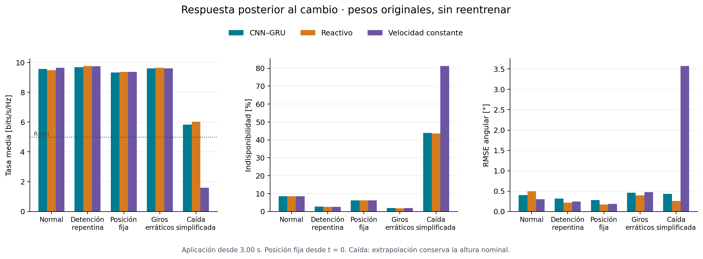
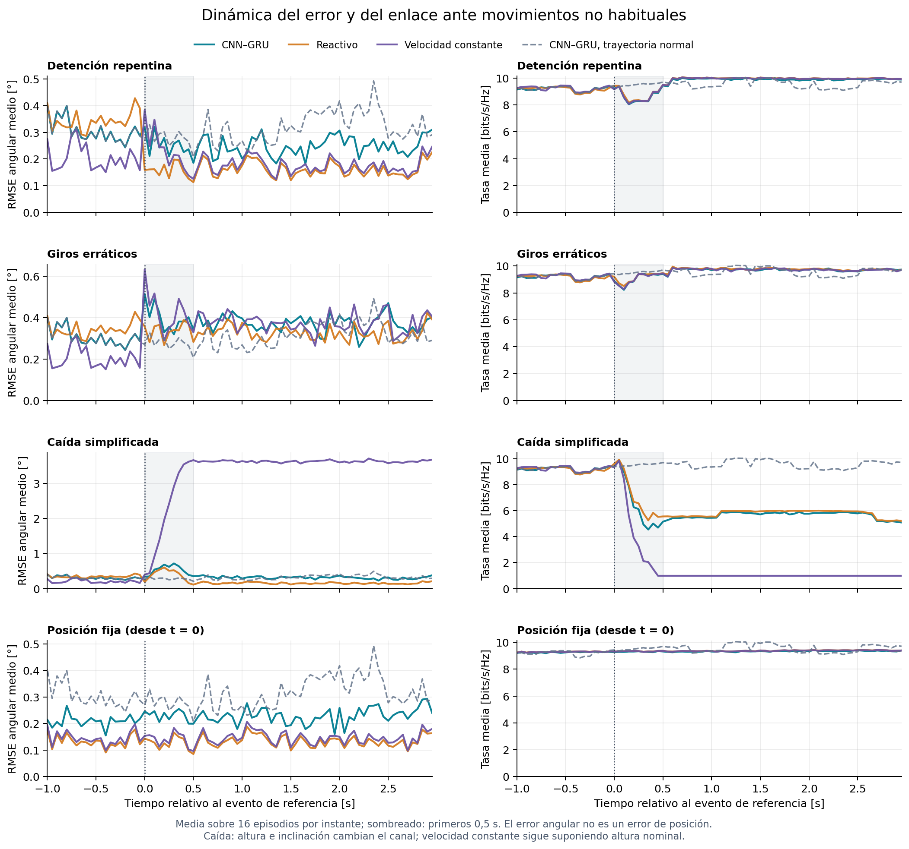
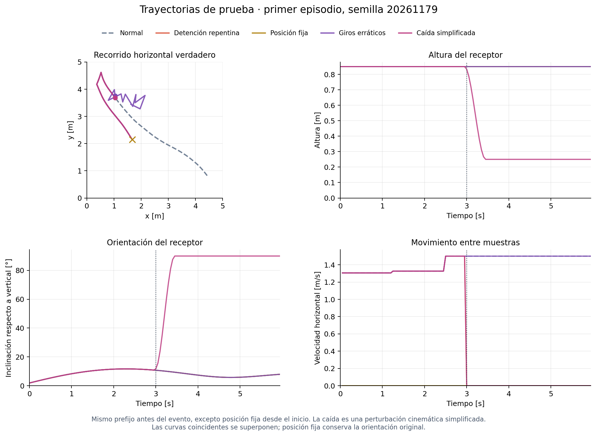

# Prueba del modelo ante movimientos inesperados

**Objetivo:** evaluar cómo responde el modelo ya entrenado cuando la persona se detiene, permanece en una posición, cambia de dirección bruscamente o su dispositivo baja y se inclina como aproximación a una caída.

Se reutilizaron los pesos existentes, sin reentrenamiento ni ajuste con estas trayectorias. La red entrega los ángulos de los espejos para el paso siguiente; no entrega una posición futura de la persona.

## Resultados principales

La comprobación de las huellas SHA256 confirmó que los archivos de pesos son idénticos antes y después de la evaluación.

- **Detención repentina:** en el primer paso afectado, CNN-GRU obtuvo 9.231 bits/s/Hz y un error angular de 0.425°. El evento aún no era visible cuando se emitió esa decisión. La diferencia de tasa respecto del reactivo fue -0.209 bits/s/Hz (IC95: [-0.382; -0.069]).
- **Posición fija:** en la ventana posterior, CNN-GRU obtuvo 9.330 bits/s/Hz, con 6.25% de intervalos por debajo del umbral y 0.279° de error angular.
- **Movimiento errático:** en la ventana posterior, CNN-GRU obtuvo 9.605 bits/s/Hz, con 1.98% de intervalos por debajo del umbral y 0.462° de error angular.
- **Caída simulada:** CNN-GRU obtuvo 5.829 bits/s/Hz y 43.96% de intervalos bajo el umbral en la ventana posterior. Este escenario modifica tanto la altura como la orientación del receptor; su degradación incluye cambios físicos del canal.

## CNN-GRU después del evento

Ventana común: desde 3.00 s hasta 5.95 s, incluyendo la primera muestra afectada. Para posición fija, el dispositivo ya estaba detenido desde el inicio; se usa el mismo intervalo temporal para facilitar la lectura. El caso normal no tiene perturbación.

| Escenario | Tasa media e IC95 [bits/s/Hz] | P5 de tasa | Bajo umbral [%] | Error angular RMSE [°] | Máximo RMSE por intervalo [°] |
|---|---:|---:|---:|---:|---:|
| Movimiento normal | 9.569 [8.400; 10.553] | 0.000 | 8.44 | 0.406 | 2.005 |
| Detención repentina | 9.689 [8.943; 10.443] | 7.950 | 2.71 | 0.318 | 1.228 |
| Posición fija | 9.330 [7.823; 10.388] | 0.000 | 6.25 | 0.279 | 0.970 |
| Movimiento errático | 9.605 [8.913; 10.293] | 7.947 | 1.98 | 0.462 | 1.978 |
| Caída simulada | 5.829 [3.508; 8.192] | 0.000 | 43.96 | 0.430 | 1.658 |

P5 es el percentil 5 de las tasas por intervalo. El RMSE angular compara los ángulos aplicados con los ángulos geométricos de la posición verdadera al aplicar el control. Incluye ruido, error de anticipación y restricciones de movimiento de los espejos.

## Primer paso y respuesta inicial

El primer paso corresponde a la aplicación en 3.00 s. La ventana inicial abarca [3.00, 3.50) s; incluye ese primer paso. Las ventanas se solapan deliberadamente para distinguir la sorpresa inicial de la respuesta durante los siguientes pasos.

| Escenario | Tasa primer paso | Error primer paso [°] | Bajo umbral primer paso [%] | Tasa primeros 0.5 s | Error primeros 0.5 s [°] | Bajo umbral primeros 0.5 s [%] |
|---|---:|---:|---:|---:|---:|---:|
| Movimiento normal | 9.429 | 0.297 | 6.25 | 9.509 | 0.363 | 6.25 |
| Detención repentina | 9.231 | 0.425 | 6.25 | 8.612 | 0.329 | 15.00 |
| Posición fija | 9.263 | 0.298 | 6.25 | 9.297 | 0.284 | 6.25 |
| Movimiento errático | 8.887 | 0.695 | 12.50 | 9.020 | 0.504 | 10.62 |
| Caída simulada | 9.390 | 0.429 | 6.25 | 6.772 | 0.625 | 33.75 |

Las tasas están en bits/s/Hz. En el primer paso, el porcentaje bajo umbral corresponde a la proporción de episodios. Esta evaluación no estima un tiempo de recuperación ni presupone que el modelo se recupere.

## Comparación con controles de referencia

Los tres métodos de esta tabla reciben la misma trayectoria y las mismas observaciones dentro de cada escenario. El reactivo apunta usando la última posición medida; velocidad constante extrapola el movimiento estimado del historial. Todos actúan con un paso de retraso. Se muestra la ventana posterior completa.

| Escenario | Método | Tasa media [bits/s/Hz] | Bajo umbral [%] | RMSE angular [°] |
|---|---|---:|---:|---:|
| Movimiento normal | CNN-GRU | 9.569 | 8.44 | 0.406 |
| Movimiento normal | Reactivo | 9.484 | 8.44 | 0.501 |
| Movimiento normal | Velocidad constante | 9.642 | 8.44 | 0.300 |
| Detención repentina | CNN-GRU | 9.689 | 2.71 | 0.318 |
| Detención repentina | Reactivo | 9.762 | 2.60 | 0.212 |
| Detención repentina | Velocidad constante | 9.741 | 2.60 | 0.248 |
| Posición fija | CNN-GRU | 9.330 | 6.25 | 0.279 |
| Posición fija | Reactivo | 9.372 | 6.25 | 0.173 |
| Posición fija | Velocidad constante | 9.365 | 6.25 | 0.188 |
| Movimiento errático | CNN-GRU | 9.605 | 1.98 | 0.462 |
| Movimiento errático | Reactivo | 9.651 | 1.77 | 0.394 |
| Movimiento errático | Velocidad constante | 9.604 | 1.98 | 0.477 |
| Caída simulada | CNN-GRU | 5.829 | 43.96 | 0.430 |
| Caída simulada | Reactivo | 6.018 | 43.54 | 0.256 |
| Caída simulada | Velocidad constante | 1.603 | 81.25 | 3.574 |

### Diferencias emparejadas de CNN-GRU

Cada diferencia se calcula con los mismos episodios. Un valor positivo de tasa significa mayor tasa para CNN-GRU en el escenario indicado; un valor positivo de indisponibilidad significa más intervalos bajo el umbral. La comparación con normal incluye el cambio de trayectoria y de canal, además de la respuesta del controlador.

| Escenario | Comparación posterior | Diferencia de tasa e IC95 [bits/s/Hz] | Diferencia bajo umbral [puntos porcentuales] | Diferencia RMSE [°] |
|---|---|---:|---:|---:|
| Movimiento normal | CNN-GRU − reactivo | +0.085 [0.036; 0.138] | +0.00 | -0.095 |
| Detención repentina | CNN-GRU − reactivo | -0.073 [-0.142; -0.019] | +0.10 | +0.106 |
| Detención repentina | CNN-GRU escenario − CNN-GRU normal | +0.119 [-0.773; 1.033] | -5.73 | -0.088 |
| Posición fija | CNN-GRU − reactivo | -0.042 [-0.072; -0.016] | +0.00 | +0.107 |
| Posición fija | CNN-GRU escenario − CNN-GRU normal | -0.239 [-1.985; 1.354] | -2.19 | -0.127 |
| Movimiento errático | CNN-GRU − reactivo | -0.046 [-0.090; -0.015] | +0.21 | +0.068 |
| Movimiento errático | CNN-GRU escenario − CNN-GRU normal | +0.035 [-0.857; 0.996] | -6.46 | +0.057 |
| Caída simulada | CNN-GRU − reactivo | -0.188 [-0.362; -0.053] | +0.42 | +0.174 |
| Caída simulada | CNN-GRU escenario − CNN-GRU normal | -3.740 [-5.860; -1.635] | +35.52 | +0.024 |

Los intervalos de confianza se obtienen remuestreando episodios completos. Describen la variación entre estas trayectorias sintéticas; una sola corrida de entrenamiento y una sola sala no permiten afirmar superioridad general de un método.

## Cómo interpretar la caída simulada

La caída es una perturbación cinemática del receptor: disminuye su altura y cambia su orientación. No representa una simulación biomecánica ni valida detección de caídas. La orientación puede sacar los enlaces del campo de visión del fotodiodo. Por eso una caída de tasa no implica, por sí sola, un fallo de anticipación del modelo.

Para separar parcialmente ambos efectos se calculan dos diagnósticos: la tasa con ángulos geométricos instantáneos obtenidos de la posición verdadera y la tasa del enlace directo sin IRS. El primer diagnóstico usa información futura y omite límites mecánicos; no es un competidor causal ni una cota máxima garantizada de la tasa.

| Escenario, ventana posterior | Tasa CNN-GRU | Tasa geometría instantánea | Bajo umbral geometría [%] | Tasa solo enlace directo |
|---|---:|---:|---:|---:|
| Movimiento normal | 9.569 | 9.817 | 8.44 | 8.159 |
| Caída simulada | 5.829 | 6.152 | 43.54 | 1.499 |

Tasas en bits/s/Hz. Los diagnósticos conservan la orientación real del receptor y los bloqueos de cada escenario.

**Limitaciones particulares de altura:** la CNN no tiene un canal de altura del receptor en sus mapas; el cálculo geométrico que se suma a su salida sí recibe la altura actual observada. La GRU de coordenadas recibe esa altura entre sus entradas. Los controles originales de velocidad constante y `geometric_j` fuerzan la altura futura al valor fijo del entrenamiento. Se conservaron esos controles: su desempeño en la caída incluye esta limitación y no debe interpretarse como una comparación aislada de capacidad predictiva.

## Protocolo y alcance

- Se evaluaron 16 episodios por escenario, separados del entrenamiento y la validación, con las mismas semillas de test del experimento original.
- Cada trayectoria contiene 120 muestras, separadas por 50 ms. El historial contiene 8 muestras. En cada decisión solo se utilizan observaciones disponibles hasta ese instante.
- Los eventos comienzan en la muestra 60, a los 3.00 s. Detención, movimiento errático y caída comparten el prefijo original hasta la muestra anterior. Posición fija se aplica desde el inicio del episodio.
- Se conserva la realización de ruido y la trayectoria original del bloqueador al construir las variantes. Su bloqueo efectivo puede cambiar porque cambia la posición del receptor. Posición fija significa ausencia de traslación; la orientación conserva su evolución original.
- El umbral de disponibilidad es Rmin = 5.00 bits/s/Hz. La indisponibilidad es la fracción de intervalos con tasa menor que ese umbral.
- Los archivos incluyen las ventanas `all` (toda la evaluación), `before` (antes del evento), `onset` (primera muestra afectada), `transition` (primeros 0.50 s), `after` (desde el evento hasta el final) y `settled` (desde 0.50 s después del evento hasta el final). Esta última ventana comienza después de la transición y de un historial completo de muestras posteriores al evento. El nombre `settled` identifica una ventana temporal; no demuestra estabilización del modelo.
- Se usa el mismo modelo físico de canal, con bloqueo, campo de visión y restricciones angulares del experimento original. Son resultados sintéticos en una geometría fija, sin mediciones reales.

## Archivos para revisar o compartir

- [Métricas por escenario, método y ventana](metrics_by_window.csv).
- [Diferencias emparejadas e intervalos de confianza](paired_differences.csv).
- [Diagnósticos de geometría instantánea y enlace directo](alignment_by_window.csv).
- [Procedencia, configuración y verificación de los pesos](provenance.json).
- [Figura resumen posterior al evento](resumen_postevento.png).
- [Figura de respuesta temporal](respuesta_evento.png).
- [Figura de trayectorias](trayectorias_estres.png).

Las carpetas de cada escenario conservan las métricas completas, las trazas por intervalo, los ángulos aplicados y las trayectorias verdaderas y observadas. Las cifras de este informe se generan directamente de los resultados de esta evaluación.
